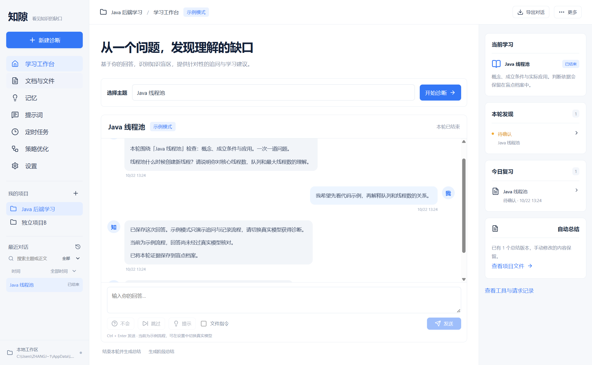

# Knowrift 知隙

知隙是面向技术学习与面试准备的 Windows 桌面应用。选择主题，通过逐题追问建立盲点档案，把学习内容保存为本地 Markdown，并安排变式复测。当前版本是课程项目 V0.1。

桌面端采用 Electron、React 和 Vite；独立的 Fastify 提醒服务通过 SMTP 发送预备邮件。学习资料和模型密钥保留在本机，云端只处理已同步的提醒。

正在进行 Java/Python 渐进重构。原有命令继续运行 Node.js 版本；新版开发入口提供 Java + SQLite 项目管理、多套模型配置，以及 Python 执行的真实连接测试。学习业务尚未迁移。详见 [首批重构实施与验收](docs/首批重构实施与验收.md) 和 [第二批模型配置实施与验收](docs/第二批模型配置实施与验收.md)。

在项目根目录的 PowerShell 中准备和启动新版：

```powershell
$OutputEncoding = [Console]::OutputEncoding = [Text.UTF8Encoding]::new($false)
$env:KNOWRIFT_JAVA_HOME = 'D:\java\jdk-17'
$env:KNOWRIFT_PYTHON = 'D:\SoftWareLearn\Miniconda3\python.exe'
npm run services:setup
npm run desktop:dev:java
```

以上路径对应本次开发机，其他电脑需替换为自己的 JDK 17 和 Python 3.14 路径。安装使用项目内虚拟环境，不修改全局 Java、Python 配置。如当前 pip 镜像不可访问，可在当前 PowerShell 会话设置 `$env:PIP_INDEX_URL = 'https://pypi.org/simple'` 后重试准备命令。Java 依赖使用本机 Maven 下载。

新版默认使用 `.data/java-dev`，`ZHIXI_HOME` 可指定独立目录；发现旧版 `projects.json` 时拒绝直接接管。关闭窗口仍留在托盘，通过“完全退出”关闭两个本机服务。本批未更新 Windows 安装包，原有安装包仍对应旧版。

新版打开“设置 → 新增配置”，填写配置名称、接口协议、基础地址和提供商的模型 ID。需要密钥时将“密钥操作”切换为“输入新密钥”；本机免密服务选择“清除密钥 / 本机免密”。保存后可分别点击“测试连接”和“设为当前配置”。配置全局共享，测试其他配置不会更改当前选择；重启后配置、密钥和当前选择保留，测试结果需重新获取。

| 新版协议 | 基础地址示例 | 程序追加的路径 |
| --- | --- | --- |
| Chat Completions 兼容 | `https://dashscope.aliyuncs.com/compatible-mode/v1` | `/chat/completions` |
| Anthropic Messages | `https://api.anthropic.com/v1` | `/messages` |
| Ollama 原生 Chat | `http://127.0.0.1:11434` | `/api/chat` |

新版只使用界面保存的密钥，不自动读取环境变量或旧版设置。每套密钥独立加密，已保存值不回显。Python 暂时不可用时仍可保存和切换配置；连接测试需要两个服务就绪，测试会向所填服务发起一次真实推理，可能产生调用费用。

## 工程目录

项目根目录为 `Knowrift`，前后端分别维护 package.json，使用 npm workspaces 统一安装和执行命令。

```text
Knowrift/
  frontend/             # React 前端
    src/                # 页面、组件、状态与样式
    index.html
    vite.config.mjs
    tsconfig.json
    package.json
    dist/               # 前端构建产物
  backend/              # 旧版 Node.js 业务及新版本机服务
    java/               # JDK 17、项目与模型配置、SQLite
    agent/              # Python 模型调用、独立虚拟环境
    core/               # 诊断、模型、文件、记忆、导出和策略逻辑
    cloud/              # 独立 HTTP 提醒服务、Docker 和部署说明
    fixtures/           # 应用内置的评测样例
    scripts/            # 真实模型联调脚本
    tests/              # 后端测试
    package.json
  desktop/              # Electron 桌面入口与系统适配
    main.cjs
    preload.cjs
    assets/             # 桌面图标
    scripts/            # 桌面开发启动器
  tests/                # 跨前后端的桌面验收及排版素材
  scripts/              # 示例生成、云端打包和 Word 验收工具
  docs/                 # 需求、设计、验收和演示文档
  examples/             # 可导入的学习示例
  design/               # 界面设计参考
  release/              # Windows 安装包与云端部署包
  package.json          # 工作区、统一命令与 Electron 打包配置
  package-lock.json     # 整个工程的依赖锁文件
```

前端负责显示和交互，通过 IPC 调用桌面主进程。桌面入口负责系统适配、凭据与本机服务管理；旧版学习业务由 `@knowrift/backend` 提供，新版配置由 Java 保存，模型请求由 Python 执行。`backend/cloud` 可以部署为独立的提醒服务。

根目录执行一次 `npm ci` 即可安装全部工作区依赖。也可单独执行 `npm run dev --workspace @knowrift/frontend`、`npm test --workspace @knowrift/backend`。增加依赖时指定对应 workspace，避免前后端依赖重新混在根配置中。

## 启动

Windows 安装包位于 `release/知隙 Setup 0.1.0.exe`。也可以直接运行 `release/win-unpacked/知隙.exe`。安装包未进行发布者代码签名。

云端部署压缩包为 `release/知隙云端服务-0.1.0.zip`，校验值记录在 `release/SHA256SUMS.txt`。完整示例项目位于 `examples/Java线程池`，可在“新建项目 → 导入已有项目”中选择该目录。

源码需要 Node.js 24 和 npm。在项目根目录的 PowerShell 中执行：

```powershell
npm ci
npm run desktop
```

首次启动会创建明确标识的 Java 示例项目。示例模式用于体验流程，不生成真实掌握评价。窗口关闭后应用留在托盘，可通过托盘菜单完全退出。

开发与检查：

```powershell
npm run desktop:dev  # Electron + Vite 热更新
npm run dev          # 浏览器预览，仅供本地开发
npm run build        # TypeScript 检查与前端构建
npm test             # 本地服务、文件、调度与模型协议测试
npm run test:e2e     # 真实 Electron 控件与导出验收，使用隔离临时目录
npm run pack         # 构建 Windows NSIS 安装包
npm run pack:cloud   # 构建独立云端服务部署压缩包
```

浏览器预览的数据保存在 `.data/preview`，与桌面工作区独立。安全密钥保存、本地目录选择和 PDF 导出在桌面端完成。预览服务只监听本机，不用于公网部署。

## 配置百炼（旧版 Node.js）

在“设置 → 模型服务”中关闭示例模式，填写并保存：

| 字段 | 北京地域配置 |
| --- | --- |
| 接口地址 | `https://dashscope.aliyuncs.com/compatible-mode/v1` |
| 模型名称 | `qwen3.7-flash`，也可手动切换 `qwen3.8-max` |
| API 密钥 | 在应用内输入自己北京地域的百炼 Key |

点击“测试已保存的连接”。如果本机已有 `DASHSCOPE_API_KEY`，应用也可以使用该环境变量；不会读取 `OPENAI_API_KEY`。在应用中填写的密钥优先，由 Windows 系统加密后保存，界面不返回明文。

百炼的额度与模型 Code 有关。日期快照与不带日期的模型可能具有独立额度，应复制控制台实际有额度的完整 Code。业务空间专属接口可以直接替换上述地址；地址末尾不用填写 `/chat/completions`。地域、套餐和 Key 必须匹配。

真实联调使用 `qwen3.7-flash` 已完成连接、诊断、自动总结和文件工具调用。此前 `qwen-plus` 返回了 `AllocationQuota.FreeTierOnly`，不能据此判断其他模型没有额度。程序不会修改百炼的计费或免费额度设置。

如需从终端进行隔离联调，在已经配置 `DASHSCOPE_API_KEY` 的环境中运行：

```powershell
$env:DASHSCOPE_MODEL = 'qwen3.7-flash'
npm run test:live
```

这个命令会实际调用模型。日志不打印 Key；生成的学习记录保存在独立临时目录中。`DASHSCOPE_BASE_URL` 可指定业务空间接口。

参考：[百炼接口文档](https://help.aliyun.com/zh/model-studio/qwen-api-via-openai-chat-completions)、[免费额度规则](https://help.aliyun.com/zh/model-studio/new-free-quota)。

## 学习与文件

1. 创建项目并选择授权目录，输入主题开始诊断。每轮默认 5 个主问题，每题最多 2 次追问；单个盲点复测为 1 个主问题。
2. 回答、跳过、表示不会或请求提示。使用提示会单独记录；证据不足、引用无法对应原回答时保持待确认。
3. 打开盲点查看原问题、原回答及依据，可以纠正、针对性学习或开始变式复测。
4. 结束本轮后生成真实 Markdown。真实模型可按照当前提示词补充归纳；模型不可用时仍保留基于已保存记录的总结。
5. 在“文档与文件”中查看、编辑、搜索和恢复历史。重新生成总结会新建版本；文件写入检查 revision，避免静默覆盖外部修改。

勾选“文件指令”后可发送“读取 notes/资料.md，并把总结写入 summaries/复习.md”。Agent 的 `list_files`、`read_file`、`search_files` 和 `write_file` 受程序路径边界控制。Agent 只能在 `summaries/`、`notes/` 写入 Markdown；记忆和策略走各自的操作流程。

可以读取 Markdown、文本、JSON 和常见源码文件（Java、Python、JS/TS、SQL、XML 等），单文件上限 2 MB。首版不解析 PDF、图片、视频或二进制资料。

导出支持整段对话、选定消息和已有文件，提供 Markdown、单文件 HTML、可选择文本的 PDF、可编辑 DOCX。导出在本机执行，不需要模型；PDF 不需要安装 Office。Word 排版验收在开发机 Microsoft Word 中完成。

## 记忆与提示词

项目记忆为项目内 `MEMORY.md`；用户记忆在个人配置目录中。界面可以编辑、清空和重新加载，项目可暂停使用记忆。自动候选记忆展示来源，确认后生效；明确发送“记住：……”可直接保存。

提示词按非空项目 `PROJECT_PROMPT.md` → 非空用户 `USER_PROMPT.md` → 默认教学提示词选择，不拼接两级模板。界面展示当前内容和版本。更新从下一次请求生效，回答记录保留使用的提示词版本。

桌面默认数据位于 `%APPDATA%/知隙/workspace`（以应用界面显示的实际项目路径为准）；`ZHIXI_HOME` 可覆盖个人工作区，用于测试或便携运行。项目目录结构如下：

```text
项目目录/
  MEMORY.md
  PROJECT_PROMPT.md
  notes/
  references/
  summaries/
  .history/          # 更新前的文件副本
  .zhixi/state.json # 对话、盲点、关联、任务缓存、策略与执行记录
```

备份项目时保留隐藏目录。密钥不写入项目文件。应用内“更多 → 打开项目目录”用于定位文件；个人提示词和记忆的目录也可从对应页面打开。

## 部署提醒服务

代码支持独立运行和 Docker。要在电脑关机后发送邮件，必须把服务部署到持续在线的服务器，并配置真实 SMTP。当前交付包含服务代码与本地验证；没有代为部署到公网或发送真实邮件。

在根目录中准备配置：

```powershell
Copy-Item -LiteralPath 'backend/cloud/.env.example' -Destination 'backend/cloud/.env'
```

在服务器本地编辑该文件，填写 SMTP 主机、端口、账号、密码和 `MAIL_FROM`；`ALLOWED_EMAILS` 限定本人和朋友的试用邮箱。不要提交 `.env`。

```powershell
docker compose -f backend/cloud/compose.yaml up -d --build
docker compose -f backend/cloud/compose.yaml logs --tail 50
```

容器端口默认只绑定服务器 `127.0.0.1:4319`。通过服务器上的 HTTPS 反向代理暴露服务，保留该端口本地绑定。健康检查为 `GET /health`，其中 `mailConfigured` 表示服务配置了邮件通道，不代表邮件已送达。持久化卷保存任务和执行记录；课程版只运行一个调度实例，不要配置多副本。备份 `/data/cloud.json`。

不使用 Docker 时，可设置同名环境变量后运行 `npm run cloud`。在工程根目录也可运行 `node --env-file=backend/cloud/.env backend/cloud/server.mjs`；端口默认 4319，持久化目录默认根目录的 `.data/cloud`。

桌面设置中填写 HTTPS 提醒服务地址和本人收件邮箱，申请验证码并验证。创建任务时预览正文和规则。离线任务为“待同步”，同步成功后才显示云端已同步。更换邮箱或服务前先暂停并同步原任务。

服务支持一次性、每日、每周和时区。已核实学习记录生成每日摘要，跨项目同一天合并一封，没有到期知识点时不发。独立任务各自执行。失败重试间隔 1、5、15 分钟；同一计划有唯一执行记录，SMTP 接受仅显示“已提交邮件渠道”。中断时无法确认提交的记录显示“结果不确定”。桌面运行时提供到期系统通知。

## 策略优化

在“策略优化”中记录并核实反馈，生成候选策略。逐条核对 20 条样例的题目、回答、标签和参考资料：前 10 条为开发集，后 10 条为验收集。初始标签没有冒充人工审核结果。

真实评测使用同一模型、同一教学提示词，对原策略和候选策略各发 20 次请求，记录分类、理由、建议追问与耗时。只有验收正确数上升且没有原本正确样例退步，才允许人工启用。建议追问条数是模型本次提出的追问数，是否必要仍需要人工查看理由；它不是实际完成多轮复测的次数。

启用只影响当前项目，可以停用或回退。模型或提示词变化后需要重新验证才能启用新候选。测试中使用模型桩验证了启用和回退逻辑，这不构成真实学习效果改善的证据。最终真实评测及人工启用须在样例核对后进行。

## 文档与验收

- [需求规格说明书](docs/需求规格说明书.md)
- [设计与实现](docs/设计与实现.md)
- [验收记录](docs/验收记录.md)
- [课程演示步骤](docs/演示步骤.md)
- [界面概念参考](design/concept.png)



本地功能和导出可离线使用。真实学习分析取决于模型服务；邮件接收依赖部署中的云服务和发信渠道。当前没有将尚未执行的公网邮件或策略效果验收标记为通过。
