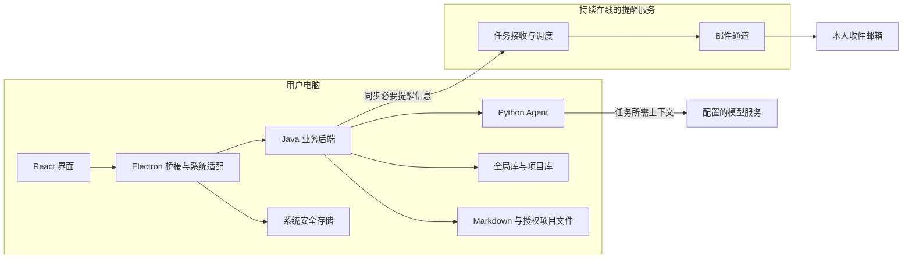

# Knowrift 重构讨论与决策记录

记录日期：2026-10-22。

本文汇总关联聊天末尾的重构建议，以及本次围绕部署、模块职责、存储和任务流程的讨论，作为后续继续讨论和编写实施计划的依据。

**首批 Java/SQLite 项目管理、Python 服务骨架及桌面接入已实现，并通过本机验收。学习业务迁移和旧 JSON 数据迁移尚未实施。当前实现与逐项验收结果见 [首批重构实施与验收](首批重构实施与验收.md)。**

第二批接入多套模型配置、全局当前选择、独立加密密钥和 Python 真实连接测试，见 [第二批模型配置实施与验收](第二批模型配置实施与验收.md)。支持 Chat Completions 兼容接口、Anthropic Messages、Ollama 原生 Chat；保存、测试和启用分别操作，允许未经测试直接启用。新版不自动读取环境变量或旧版模型设置。学习业务、流式任务及新版安装包继续留待后续批次。

文中的“已确认”表示讨论中确定的方向；“设计草案”表示已讨论的具体建议，仍需在后续批次细化；“待讨论”表示尚未定案。项目管理及本机服务的实际实现以首批实施文档为准，模型设置以第二批实施文档为准；其余尚未实施的目标能力不表示已经完成。

## 一、已确认的方向

| 项目 | 结论 |
| --- | --- |
| 产品定位 | 本地使用的知识盲点学习助手，服务技术学习与面试准备 |
| 求职展示目标 | 展示完整 Java 后端业务、Agent 开发能力和一定的全栈能力 |
| 使用形态 | 本地桌面应用；独立 Web 版暂缓，不作为此次重构的主要交付目标 |
| 技术方向 | React/TypeScript 前端、Electron 桌面适配、本机 Java 业务后端、本机 Python Agent |
| Java 技术方向 | 统一 JDK 17；Spring Boot 4.1.1、Spring MVC、Spring JDBC、SQLite JDBC 3.53.4.0 |
| Agent 编排 | Python 自行实现受控学习状态机及自主文件工具循环，不引入编排框架 |
| 中断与展示 | 保留已保存记录，由用户手动重试；展示阶段进度和流式文字，最终结果由 Java 校验提交 |
| 迁移方式 | 复制旧项目到新目录后导入，原目录保留；首批不执行旧数据迁移 |
| 云端边界 | 云端仅承担邮件提醒相关服务，不承担学习诊断和 Agent 推理 |
| 业务数据写入责任 | 本机 Java 统一管理业务记录及项目文件的写入，Python 通过受控接口请求操作 |
| 本地存储选型 | SQLite 保存结构化记录，Markdown 保留可编辑内容，系统安全存储管理密钥和登录凭据 |
| 数据库布局 | 全局登记库 `app.db` 加每项目独立的 `project.db`，用户已明确选择此方案 |
| 重构范围 | 默认迁移现有能力；新增功能另行记录并确认后纳入 |

之前曾建议优先考虑 Web 云端方案，随后用户明确重申本地使用的产品定位。后续设计以本文记录的本地桌面方案为准。

## 二、目标架构与邮件提醒边界

### 2.1 模块职责

| 模块 | 主要职责 |
| --- | --- |
| React | 对话、盲点、文档、记忆、提示词、任务和评测结果的展示及交互 |
| Electron | 窗口、目录选择、系统凭据、PDF 打印、桌面通知，以及后端进程的启动和退出回收 |
| Java 业务后端 | 项目、会话、消息、盲点状态、复习计划、数据持久化、文件权限与版本、记忆确认、策略启用、提醒同步 |
| Python Agent | 上下文组织、模型调用、问题生成、诊断建议、追问建议、总结、受控工具编排和策略评测 |
| 云端提醒服务 | 接收必要提醒信息、定时调度、提交邮件渠道、失败重试和执行记录 |

Java 保持一个业务服务，内部按业务模块组织，工程位于 `backend/java`；Python 独立服务位于 `backend/agent`，使用 Python 3.14、FastAPI 0.159.1 和 Uvicorn 0.54.0。Python 自行编排；业务走本机 HTTP，后续模型进度和文字流使用 SSE，再由 Electron IPC 转发给界面。首批仅提供项目管理和服务状态，不实现模型流。

Electron 为每个服务生成独立令牌及实例标识，通过标准输入传递。两个服务监听 `127.0.0.1` 的动态端口；探活校验协议版本、实例身份和就绪状态。完全退出时先请求关闭，等待最多 10 秒，再终止本次启动的剩余进程；服务监视父进程管道以处理异常退出。关闭窗口留在托盘的行为保留。



本地保存学习记录与调用远程模型是两个不同边界。沿用百炼等模型服务时，诊断需要把当前任务所需上下文发送给配置的模型服务；“本地使用”不表示所有模型推理均离线进行。

### 2.2 电脑关机后的提醒

电脑完全关机后，本地程序无法继续执行。要在关机后发送提醒，需要提前把计划同步到持续在线的云端提醒服务。

示例流程：

1. 用户在本机学习线程池，本地程序记录盲点并安排复习。
2. 本地同步“明早 9 点复习线程池扩容条件和拒绝策略”等提醒信息。
3. 用户关闭电脑。
4. 云端到点根据已同步计划发送邮件，用户从邮件中得知应复习的知识点。
5. 用户再次打开应用后，查询执行结果，并同步后续复测产生的计划变更。

云端仅保存提醒所需的邮箱、知识点标题、时间规则、必要正文和执行记录等信息。完整学习对话、笔记、记忆、提示词和模型密钥保留在本机。SMTP 凭据由云端服务管理。

云端以最后一次成功同步的计划为准。尚未同步的新任务、修改或取消，无法在电脑关机后自动生效。云端不需要运行学习 Agent，也不需要在发送时重新调用模型。

源码已有独立提醒调度与同步逻辑。现有验收文档仍将公网部署、真实 SMTP 和真实关机后收信列为未验证项；本次整理没有重新执行这些验证。SMTP 接受邮件也不能直接等同于用户已收信。

## 三、存储布局

### 3.1 建议目录

以下是目标布局示意，配置根目录的兼容处理待迁移设计确定：

```text
个人配置目录/
  app.db                    # 项目登记、非密钥通用设置
  personal/
    MEMORY.md               # 用户级记忆
    USER_PROMPT.md          # 用户级提示词

用户授权的学习项目目录/
  .zhixi/
    project.db              # 项目身份及结构化学习记录
  MEMORY.md                 # 项目记忆
  PROJECT_PROMPT.md          # 项目提示词
  notes/
  references/
  summaries/
  .history/                 # 文件历史版本
```

### 3.2 数据归属

| 位置 | 保存内容 |
| --- | --- |
| 全局库 `app.db` | 项目 ID 与本机目录的登记关系、归档状态、最近打开时间、模型地址与名称、时区等非密钥通用设置 |
| 项目库 `project.db` | 稳定的项目身份、项目名称、会话消息、诊断与盲点证据、复习计划、文档关联、候选记忆、策略评测、提醒与同步执行记录 |
| 项目 Markdown | 项目记忆、项目提示词、笔记、学习总结和资料内容 |
| 个人 Markdown | 用户级记忆与用户级提示词 |
| 系统安全存储 | 模型密钥和云端登录凭据；不写入项目库、提示词、日志或普通备份 |
| 云端独立存储 | 已同步的提醒信息和执行结果，与本机数据库文件分离 |

选择每项目独立库，是为了便于单个学习项目独立备份、迁移和恢复。代价是跨项目查询，例如“所有项目今天待复习的内容”，需要 Java 汇总多个项目库。

### 3.3 存储约定

- 项目身份与目录分开：移动项目目录后保留项目 ID，更新全局登记路径；“复制为新项目”需要新身份。
- 项目名称等业务元信息以项目库为来源，全局登记不另行维护一份独立业务事实。
- 同一信息设置一个权威来源：下次复习时间由复习计划管理；文档正文由 Markdown 管理，数据库保存路径、版本和来源关联。
- Python 通过 Java 获取业务上下文和请求变更，不与 Java 共同直接修改业务数据库。
- SQLite 同一时刻只有一个写入者；写事务保持简短，模型调用和网络同步在事务之外执行。
- SQLite 事务只覆盖对应数据库内的操作，不把项目库、全局库、Markdown 文件和云端请求视为一个原子事务。跨边界的失败恢复方式仍需细化。
- 运行中的备份由应用生成一致性数据库快照，再与相应 Markdown 打包；数据库与文档的快照协调、恢复流程和备份格式待设计。

## 四、核心数据关系草案

下面先确定业务实体和关系，尚未形成完整 SQL、字段类型、索引及外键定义。

| 数据组 | 核心实体 | 作用 |
| --- | --- | --- |
| 项目登记 | 项目登记、通用设置 | 定位项目目录，加载非密钥个人配置 |
| 项目身份 | 项目元信息 | 保存稳定的项目 ID、名称和创建信息 |
| 对话 | 会话、消息 | 恢复对话内容、顺序和诊断进度 |
| 诊断 | 诊断任务、诊断结果、证据 | 关联原问题、原回答、判断依据和本次执行 |
| 盲点 | 盲点及其证据关联 | 保存当前学习状态，持续积累追问和复测证据 |
| 复习 | 当前复习计划 | 管理下次复习时间及复测安排 |
| 文档 | 文件元数据及来源关联 | 关联路径、版本、文件类型和来源会话 |
| 提醒 | 提醒任务、待同步变更、执行记录 | 区分本地安排、同步状态和云端发送结果 |
| 记忆与策略 | 候选记忆、反馈、策略版本、评测记录 | 保留来源、审核、人工启用与回退依据 |

已讨论的关联原则：

1. 一个项目有多个会话，一个会话有多条消息。
2. 诊断任务关联已保存的回答；重试复用原回答，执行记录可单独追踪。
3. 同一盲点可以关联多次回答、追问和复测证据，新增结果不覆盖历史依据。
4. 每个盲点维护一份当前复习计划，复测后更新计划，历史复测依据仍可追溯。
5. 提醒任务、待同步变更和云端执行记录分别保存，不能把本地保存误表示为云端已启用。
6. 文档正文仍在文件中，数据库负责文件与对话、总结、执行记录之间的关联。

具体拆表方式、状态枚举、字段约束，以及历史记录与当前状态的一致性规则，待数据模型细化时确定。

## 五、一条完整学习链路

讨论使用的示例为：**回答一道题 → 发现盲点 → 安排复习 → 同步提醒**。

### 5.1 执行顺序

1. **界面提交回答。** 传递项目、会话、回答内容和本次操作的 `clientRequestId`。
2. **Java 先保存回答并创建诊断任务。** 返回 `messageId` 和 `runId`；模型后续失败时，已提交回答仍保留。
3. **Java 在事务外调用 Python。** 提供当前问题、回答、必要历史、提示词和记忆等上下文。
4. **Python 生成诊断建议。** 返回判断、原话证据、解释和建议追问，不直接提交业务状态。
5. **Java 校验结果。** 核对证据、提示使用情况、追问次数、任务有效状态等业务规则。
6. **Java 在一个项目库事务中提交相关结果。** 保存诊断及关联记录，按需要更新盲点、复习计划，并登记待同步提醒变更。
7. **事务提交后同步云端。** 同步失败保留待同步状态并重试，本地学习结果不丢失。
8. **界面展示任务结果和最新状态。** 进度通道和刷新协议待接口设计确定。

### 5.2 失败与重复执行原则

- 同一 `clientRequestId` 的重复提交返回原任务，避免重复保存回答。
- 模型失败后，重试复用已保存回答，只重新执行诊断；具体重试接口待定义。
- 取消生效后，迟到的模型结果不再修改业务状态。
- 取消与完成并发时的状态判定，由 Java 的任务状态更新保证，具体条件待协议设计确定。
- 文件写入检查授权目录及版本，发生冲突时保留现有内容和可恢复的版本。
- 云端同步和发信失败分别记录，不把“待同步”“已提交邮件渠道”和“已送达”混为一种状态。

## 六、接口与任务草案

前端目标是使用有类型的 `LearningApi`，逐步替换当前宽泛的 `invoke(action, args)` 调用参数。桌面系统能力仍由 Electron 桥接。

| 暂定接口名 | 调用方向 | 用途 |
| --- | --- | --- |
| `submitAnswer` | 界面 → Java | 保存回答，返回诊断任务标识 |
| `getRun` | 界面 → Java | 查询任务进度、结果或错误 |
| `cancelRun` | 界面 → Java | 请求取消指定任务 |
| `diagnose` | Java → Python | 根据上下文生成诊断建议 |

暂定标识语义：

- `clientRequestId`：标识一次用户提交，供去重使用。
- `messageId`：标识已经持久化的消息。
- `runId`：标识一次 Agent 执行，关联进度、结果、取消和错误。

上述名称是学习任务的最小接口草案，其 HTTP 路径、完整请求响应类型、业务超时、重试、取消确认和进度事件格式仍需后续细化。通用本机认证和进程协议已采用首批的令牌、实例标识及协议版本 1。提醒任务身份需要与 Agent 执行身份区分。

本机 Java、Python、Electron 之间的通信地址、动态端口、进程访问控制、凭据传递和退出回收已在首批实现，具体接口见实施文档。

## 七、需要保留的现有行为

重构默认保留现有学习流程和产品能力，重点包括：

- 项目隔离、导入已有目录、重启恢复已发送消息与进度。
- 默认 5 个主问题，每题最多 2 次追问；提示后作答、跳过和证据不足分别处理。
- 盲点判断关联原问题、原回答及诊断依据；无法对应原话时保持待确认。
- 总结自动保存，手动修改和历史版本得到保留。
- 文件访问受授权目录及 revision 检查约束。
- 用户与项目记忆可见可编辑；自动候选确认后生效，明确“记住”指令沿用已有保存流程。
- 提示词按照非空项目提示词、非空用户提示词、默认模板的顺序选择，记录生效版本。
- 候选策略经过评测和人工启用，支持停用、回退，评测结果不冒充真实学习效果。
- Markdown、HTML、PDF、DOCX 四种导出能力。
- 离线任务保存为待同步；提醒修改、暂停、恢复和取消需要同步云端。
- 示例与真实模型结果明确区分；失败保留数据，不把尝试表示为完成。

## 八、迁移与验收：后续实施计划的输入

采用渐进迁移，保留旧版可运行行为作为基线。首批执行第 1、2 阶段，后续阶段仍需按各批行为细化：

| 阶段 | 候选内容 | 预期可验证结果 |
| --- | --- | --- |
| 1 | 固定现有功能、样例、数据格式和测试基线 | 重新执行并记录基线结果 |
| 2 | 新后端骨架、最小契约、统一启动及 Java 项目管理 | 界面创建项目 → Java 保存 → 重启恢复 |
| 3 | 会话、盲点、文件、记忆、提示词和复习业务 | 使用模型桩验证业务流程与文件冲突 |
| 4 | Python 模型调用、诊断、追问、总结、工具与评测 | 完成真实诊断并生成本地总结 |
| 5 | 任务进度、取消、提醒同步、导出和失败恢复 | 离线、重复操作及恢复流程通过 |
| 6 | 旧项目迁移、云端提醒兼容、Windows 打包 | 打开旧项目、启动与退出、完整验收通过 |

首批已确定：独立新版数据根目录；Java 模式跳过旧业务初始化；全局创建意图加项目身份标记恢复创建中断；JDK 17 和 Python 独立虚拟环境；本机动态端口、认证探活及退出回收。后续批次仍需细化：

- 旧 JSON 导入、备份、数量与关联校验、迁移中断恢复及回退方案。
- 完整业务迁移后的默认后端切换，以及迁移后提醒身份的连续性。
- Java 运行时与 Python 服务在 Windows 安装包中的分发。
- 云端提醒服务的技术实现及迁移时机；目前不因本地改用 Java 就默认重写云端服务。

最终验收至少覆盖：完整学习流程、追问边界、诊断证据、模型失败与取消、重启恢复、文件权限与版本冲突、重复提交、提醒同步与去重、真实关机后邮件，以及旧项目迁移和回退。

本批已重新执行现有服务测试、旧版桌面验收和新增 Java/Python/新版桌面验证，结果记录在首批实施文档。后续能力仍需独立实施和验收，不沿用历史“通过”结论。

## 九、讨论进度与下一轮

| 轮次 | 主题 | 当前状态 |
| --- | --- | --- |
| 1 | 产品形态与部署 | 已确认本地桌面使用，云端仅承担邮件提醒 |
| 2 | 模块职责与数据归属 | 核心分工已讨论，Java 统一管理业务及项目文件写入 |
| 3 | 存储与旧数据兼容 | SQLite 及全局库加项目库布局已确认；数据关系已有草案，具体表结构和迁移待细化 |
| 4 | 接口与任务执行 | 已讨论最小接口、保存顺序、去重和取消原则；完整协议待细化 |
| 5 | Agent 内部设计 | 已确认受控学习流程、自主文件工具、自行编排、手动重试和流式预览 |
| 6 | 工程组织与交付 | 首批已确定 JDK 17、服务目录、HTTP/IPC、启动及回收；安装包后续实施 |
| 7 | 分批迁移与验收 | 首批项目管理闭环已实现并通过本机验收；旧项目复制迁移和完整业务验收在后续批次 |

首批完成后，下一轮细化学习业务和 Agent 的执行协议：

1. 诊断、追问、复测、总结与文件工具分别采用怎样的执行流程。
2. 将已确定的固定学习流程和自主文件工具循环映射到任务状态。
3. 上下文、记忆、提示词和策略如何组装与记录版本。
4. 保留已提交记录、手动重试及人工确认节点的具体业务规则。
5. 模型返回如何校验、评测，以及如何提交给 Java 业务层。

每轮继续按照“核对现有行为 → 比较实际方案 → 确认关键取舍 → 更新决定与未决事项”的方式推进。完成各轮讨论后，再形成可以直接开发的实施计划。

## 十、来源与参考

- [关联聊天：为知隙确定英文名并讨论需求](thread://01a16103-f5bb-7a32-8b8f-a5091c3b0102?hostId=local)，以及本次聊天中的后续讨论与用户选择。
- [当前需求规格说明书](需求规格说明书.md)、[当前设计与实现](设计与实现.md)、[已有验收记录](验收记录.md)：描述现有版本，不表示本文目标架构已经实现。
- [当前业务服务](../backend/core/service.mjs)、[当前数据仓库](../backend/core/repository.mjs)、[当前文件存储](../backend/core/storage.mjs)：当前仍为 Node.js 与 JSON 实现。
- [SQLite 适用场景](https://www.sqlite.org/whentouse.html)：本地应用存储选型参考。
- [SQLite WAL 与并发](https://www.sqlite.org/wal.html)：读写并发和事务边界参考。
- [SQLite 备份接口](https://www.sqlite.org/backup.html)：一致性数据库快照参考。
- [SQLite JDBC](https://github.com/xerial/sqlite-jdbc)：Java 接入候选，尚未添加到项目依赖。
